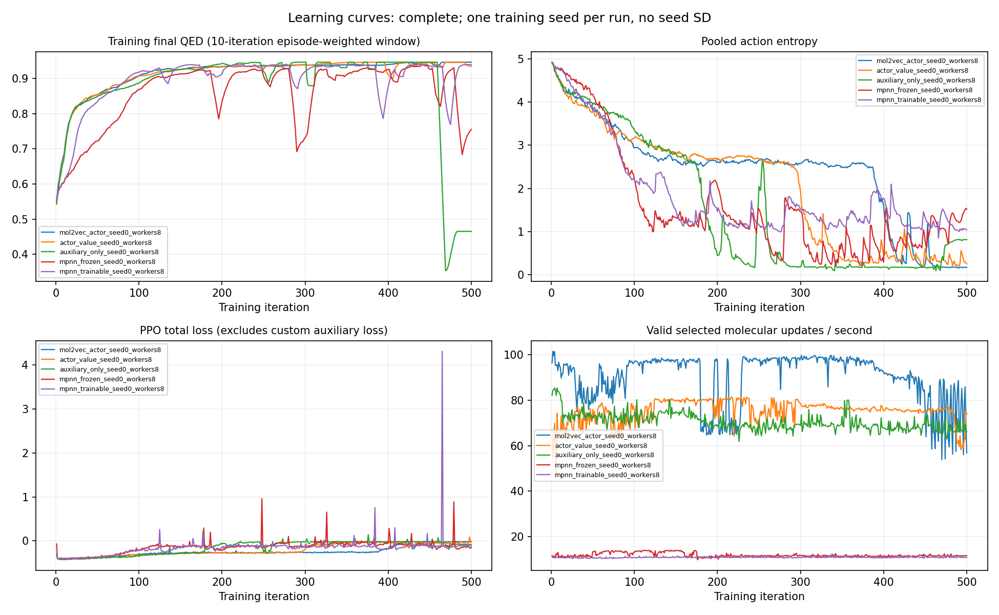
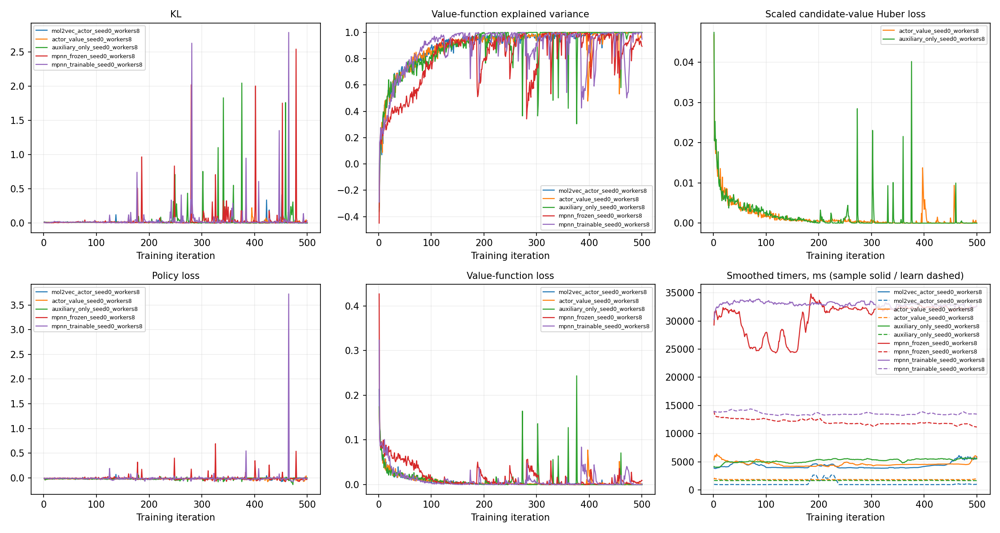
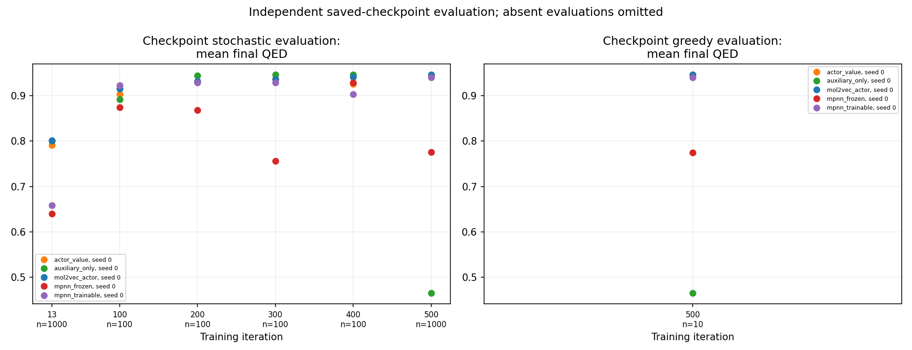
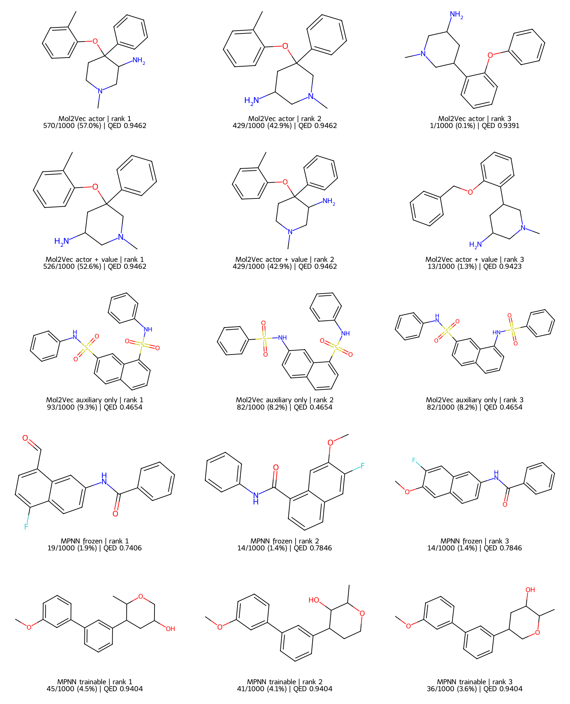

# 5構成・1 seed・500反復の比較

今回のseed 0では、**QEDと速度はMol2Vec単独、品質を保った生成種類数は同時学習GNN**が良かった。候補価値を加えたMol2Vecは、単独とほぼ同じQEDで生成種類数が増えた。一方、補助学習だけの構成は学習後半に悪化した。1 training seedの観測であり、構成一般の優劣やseed間の有意差は示していない。

## 最終モデルの評価

各モデルの500反復チェックポイントから、初期分子を`C`、評価seedを0〜999として、`explore=true`で1,000エピソードずつ生成した。全5構成とも1,000件が妥当な分子で、すべて原子数閾値で終了した。

| 構成 | 平均QED | canonical unique / 1,000 | 最頻分子の割合 | fingerprint diversity | QED ≥ .94のunique数 |
|---|---:|---:|---:|---:|---:|
| Mol2Vec単独 | 0.946198 | 3 | 57.0% | 0.231691 | 2 |
| Mol2Vec＋候補価値 | 0.945771 | 18 | 52.6% | 0.266007 | 9 |
| Mol2Vec＋補助学習のみ | 0.465438 | 20 | 9.3% | 0.393316 | 0 |
| MPNN固定 | 0.775238 | 325 | 1.9% | 0.721748 | 1 |
| MPNN同時学習 | 0.940248 | 74 | 4.5% | 0.504193 | 63 |

fingerprint diversityは、radius 2・2,048 bitのMorgan fingerprintの全分子ペアについて、Tanimoto類似度の平均を1から引いた値。重複分子も標本の頻度どおり含む。QED ≥ .94は事後の感度分析用の品質条件であり、学習報酬・終了条件・事前指定benchmarkではない。

MPNN同時学習ではQED ≥ .94が988エピソード・63種類、Mol2Vec単独では999エピソード・2種類、候補価値ありでは984エピソード・9種類だった。固定MPNNは325種類を生成したが、QED ≥ .90は20エピソード・18種類にとどまる。種類数だけで品質を判断できない。

Mol2Vec単独は高いQEDの少数分子へ集中している。確率的なサンプリングでも種類数は3であり、greedy評価だけに由来する繰り返しではない。部品選択phaseの正規化エントロピーの平均は約0.000229で、1,709行のうち実際に使用したのは3行だった。候補価値ありは7行、同時学習MPNNは11行、固定MPNNは51行（canonicalでは49種類）を使用した。未使用の部品が到達不能・不要であることを示す測定ではない。

greedy評価も各10回行った。各構成で同じ最終分子が10回生成され、QEDは順に0.946205、0.946205、0.465438、0.774512、0.940410だった。これは同じ初期状態に対する決定的な選択の再現確認であり、10個の独立した学習結果ではない。

## 学習時間と速度

全構成を同じGPU上で直列実行した。各500回の`algo.train()`を計測し、最初の3回も含む。追加のwarmup反復は行っていない。

| 構成 | 学習時間の合計（分） | 秒 / 反復 | 実分子更新数 | 分子更新 / 秒 | 評価episode / 秒 |
|---|---:|---:|---:|---:|---:|
| Mol2Vec単独 | 48.22 | 5.786 | 255,986 | 88.48 | 22.39 |
| 候補価値あり | 56.97 | 6.836 | 255,986 | 74.89 | 21.86 |
| 補助学習のみ | 60.60 | 7.272 | 255,987 | 70.40 | 18.48 |
| MPNN固定 | 359.79 | 43.175 | 255,887 | 11.85 | 4.26 |
| MPNN同時学習 | 391.30 | 46.956 | 255,985 | 10.90 | 4.11 |

学習時間は記録された`algo.train()`時間の合計であり、モデル・Rayの起動、チェックポイント保存、出力、終了処理を除く。更新数は化学環境が記録した実数で、`500 × 1024 / 2`による理論値ではない。評価速度はエピソード処理と診断capture・entropy取得を含み、起動・復元・出力・事後の化学分析を除く。

今回の実装・設定では、同時学習MPNNの更新速度はMol2Vec単独の約1/8.1だった。固定MPNNも毎回のencodeを行い、埋め込みキャッシュは0としている。固定catalogのgraph整数レコードは再利用するが、forwardごとのgraph packingとMPNN計算の費用が残る。固定encoderのcatalog埋め込み再利用やpackingの事前計算は今後の最適化候補であり、今回の比較途中では有効化していない。この速度差をGNN一般の不可避な費用とは扱わない。

記録されたGPU peak allocated memoryは順に8,255、12,467、12,469、8,762、13,452 MiB。5ジョブが同じPythonプロセスで順に動き、前ジョブから残るallocationの影響を含み得る。独立プロセスで測ったarchitecture固有のメモリ費用やreserved memoryの比較ではない。

## 追加学習と変動

100・200・300・400・500反復の比較には、各構成で共通の評価seed 0〜99、100エピソードを使う。500反復については既存の1,000エピソードから先頭100件を選び、再評価していない。異なる生成回数のunique率をそのまま学習曲線として比較しない。

| 構成 | 100反復の平均QED | 500反復の平均QED | unique数の変化（各100件） |
|---|---:|---:|---:|
| Mol2Vec単独 | 0.915823 | 0.946205 | 100 → 2 |
| 候補価値あり | 0.903238 | 0.944941 | 99 → 8 |
| 補助学習のみ | 0.892005 | 0.465438 | 100 → 19 |
| MPNN固定 | 0.874795 | 0.768782 | 91 → 85 |
| MPNN同時学習 | 0.922993 | 0.940362 | 100 → 42 |

13反復と500反復については、共通seed 0〜999の1,000エピソードで比較した。

| 構成 | 13反復QED | 500反復QED | unique数（13 → 500、各1,000件） |
|---|---:|---:|---:|
| Mol2Vec単独 | 0.801630 | 0.946198 | 1,000 → 3 |
| 候補価値あり | 0.791067 | 0.945771 | 1,000 → 18 |
| 補助学習のみ | 0.800807 | 0.465438 | 1,000 → 20 |
| MPNN固定 | 0.640019 | 0.775238 | 1,000 → 325 |
| MPNN同時学習 | 0.657985 | 0.940248 | 1,000 → 74 |

短期時点では全構成で1,000種類が得られた。今回のseedでは、補助学習のみを除く4構成でQEDが上がる一方、すべての構成で生成が集中した。QED ≥ .94のunique数は、同時学習MPNNでは5から63に増え、Mol2Vec単独では12から2になった。多様性だけ・品質だけの一指標でまとめると、この違いを見落とす。

旧13反復と今回の500反復は別の新規学習実行で、後述する数値計算・store設定の変更を含む。全5構成の先頭13反復では、learner統計と非時間の化学集計1,170項目が完全一致したが、重み全体・全軌跡・時間の同一性を証明した比較ではない。

学習中のQEDは、変化している方策で集めたエピソードの値であり、保存済みモデルの評価とは区別する。各区間の集計は`sum(quality_sum) / sum(completed episodes)`で計算した。最後50反復の学習中QEDは、順に0.944570、0.940654、0.524829、0.819039、0.902530だった。

全2,500反復の学習統計は有限で、action maskの不整合は0だった。ただし、有限であることは最適化が安定していることを意味しない。同時学習MPNNには平均KL ≥ .5が6回あり、最大は465反復の2.789064だった。そこで更新前に集めたQEDは0.940068、続く466反復では0.660506となった。その後476反復で.90以上、480反復で.93以上に戻り、500反復モデルの独立評価は0.940248だった。恒久的に崩壊したとも、学習が単調に改善したとも言えない。

反復kのQEDはその反復のoptimizer更新前のサンプル、KLはその更新の統計である。KL上昇と後続スコアの変動は時間的な関連の観測であり、原因を分離した実験ではない。6回のKL上昇のうち4回ではunderflow counterの増分が0だった。underflowが品質低下の原因だったとは主張しない。

[図表と全評価のHTMLレポート](learning500/index.html)／[機械可読の学習曲線](learning500/learning_report.json)







学習曲線のentropyはphase・候補数の混合集計で、分子の種類数にそのまま対応しない。sample/learn timerはRLlibの平滑化された診断値で、排他的な壁時計時間の割合ではない。チェックポイント図は観測した時点だけを点で表示し、評価件数を横軸に記載している。



分子図は各構成の頻度上位3種類をcanonical SMILESで同順位解消して選んだ。各種類の生成回数とQEDを表示する。Mol2Vec単独の3位は1/1,000件の稀な分子であり、この15構造が生成分布全体を代表するとは限らない。PNGに加えて同名のSVGと、選択した構造・頻度・source hashを記録したmanifestを保存する。

Git保存用の3個のプロットSVGは、出力ライブラリが付ける行末空白だけを除去した。XML構造と空白を正規化した図形属性の一致を確認し、元ファイルと保存用ファイルのSHAを集計JSONに残した。PNG・数値データ・分子図SVGは元出力のまま保存している。

## 今回確認できた限界

- **化学目的関数がQEDだけでは、多様性を維持できる保証がない。** PPOにはentropy正則化もあるが、Mol2Vec系は高QEDの少数の組立へ集中した。多様性が要件なら、品質条件を付けたunique数・頻度・scaffold等を評価指標に含める必要がある。多様性報酬、entropyや温度の調整を採用する効果は今回測っていない。
- **学習時間だけを延ばしても改善し続けない。** 補助学習のみは200反復評価のQED 0.944492から500反復で0.465438へ悪化した（いずれも共通100件で比較可能）。固定・同時学習MPNNにも後半の低下と回復がある。最終反復だけでなく途中の保存モデルと学習統計を確認する必要がある。
- **停止条件の制約がある。** 明示的なSTOP行動はなく、原子数が20を超えた後に終了する。20原子以内に保つ制約ではない。補助学習のみは全1,000件で最終QEDが選択済み中間体の最高値を下回り、差の平均は0.419433だった。固定MPNNは799件で下回り、差0も含む全1,000件での平均差は0.054984だった。この差は実際に選んだ経路上の記述で、STOPを追加した場合の改善量・未選択候補の最適値ではない。
- **候補128件の打切りは最終評価で発動しなかった。** 全5,000エピソードの選択済み部品ペアでは打切り0回だった。未選択ペアや将来経路の到達性まで調べた結果ではない。打切りは決定的なKekulé key順の先頭であり、QED上位128件ではない。
- **学習seedの一般化は未確認。** 1,000評価episodeは1,000個の学習seedではない。Mol2Vecは事前学習済み、固定MPNNはランダム初期値のまま、同時学習MPNNはPPOで更新する設定であり、architectureだけの因果比較ではない。

## 実験条件と再現

GPUはRTX 4060 Ti 16 GiB、CPUはCore i9-14900、メモリ128 GiB。Python 3.12.7、PyTorch 2.7.1+cu126、Ray 2.47.1、RDKit 2025.3.6、NumPy 1.26.4。各ジョブは8 workers、train batch 1024、minibatch 32、3 epochs、seed 0で新規に学習した。失敗した実行の途中チェックポイントを継ぎ足していない。

初期分子`C`、E2E環境、PPO、QED、固定部品表、actorによる選択が共通条件。部品表は`data/building_blocks/guacamol/guacamol_s10000_l2.csv`の全1,709行（canonical unique 1,684、最大16原子）を提示する。MPNNは3層・hidden/output 128、構造キャッシュ1024、埋め込みキャッシュ0、atom chunk 4096、gradient checkpointing無効。固定MPNNは事前学習済みencoderではない。

原子数終了閾値20、max decisions 40、接続候補上限128、QED終了閾値1.1。標準QEDは1以下なので、QED 1.1は到達する目標ではなく、この実験ではQEDによる早期終了を抑える設定である。報酬は`improvement`、final weight 1、gamma .99、lambda .95、learning rate 5e-5、entropy coefficient .1。通常は部品選択の即時報酬0、接続選択でQED差分、真の終端でQED bonusを加える。割引・終端・truncation・entropy正則化があるため、単純な最終QEDだけの最適化と同一視しない。

部品選択と接続候補選択はphaseを入力する共通actorで学習する。criticはactorとは別のMLPだが、両phaseで共通に使う。独立した上位・下位方策を持つ階層型RLではない。部品選択にもGAEで将来の報酬・価値が伝わる。候補価値あり／補助学習のみの構成には、実際に選んだ接続候補の期待収益をPPOの`value_targets`に回帰する追加損失がある。部品選択専用の補助損失は今回の比較には含めていない。

GNN graph容量は36原子・630結合の保守的な整数buffer。原子・結合は切り捨てず、容量超過時はエラーになる。原子数閾値以下から最大16原子の部品をmergeする場合の上限はnode mergeで35原子、edge mergeで34原子だが、すべての組立が実際に到達可能であるとの証明ではない。

学習revisionは`b5a9e41d5fe7f8fabb22f8739cdeb43ec175bd2a`。manifestに49個のcore source hash、解決済みconfig、seed、version、catalog・assetのhashを保存した。学習中のcore/configは変更していない。ローカルのTensorBoard/RLlibログ・measurement・チェックポイントを保持し、外部loggerへの送信は行っていない。

```bash
env OMP_NUM_THREADS=1 OPENBLAS_NUM_THREADS=1 MKL_NUM_THREADS=1 \
  .venv/bin/python -m moldr.cli sweep \
  --config configs/short.yaml --sweep configs/sweeps/learning500.yaml \
  --output artifacts/experiments_learning500_store16g
```

本実行ではRay object storeを16 GiBに指定した。最初の試行は429反復目のKL非有限化で失敗し、有限logitの確率underflowを安定に扱うKLへ修正した。2回目は旧512 MiB storeでrollout batchのrestoreが繰り返され、所有プロセスを確認して中断した。3回目に全5構成を新規に500反復実行した。

同一Ray nodeの監視記録では16 GiB・累積spill/restore 0だった。ただし、固定MPNNは最後8.307秒、同時学習MPNNは最後9.352秒を覆う後続dumpがなく、その末尾までspill-freeと証明したとは扱わない。旧13反復モデルの再評価では保存設定にstore予算がなくRay自動設定を使うため、旧13と500の推論速度を厳密なresource一致比較としては扱わない。

## 完了監査と保存先

全5ジョブに1〜500の連番・各1024 decisionsの記録があり、合計2,500回の学習を確認した。100・200・300・400・500反復の各チェックポイントについて、学習・評価時のSHAと実ファイルを照合した。

独立した評価は7組・35件・合計12,050エピソード。500反復の確率的評価は各1,000件、greedyは各10件、100〜400反復は各100件、旧13反復は各1,000件。評価はworker 0・GPU 1・actor選択で、追加の学習更新は行っていない。完了マーカーだけでなく全エピソードの実ファイルを別途確認し、seed・SMILES・スコア・終了情報と集計の一致を検証した。asset 72ファイルとチェックポイント120ファイルのSHAも一致した。評価manifestの61 source中、評価後に変更した描画用の`learning_report.py`だけは旧・現SHAを別記し、評価runtimeと49個のcore sourceの一致を確認した。

CPUで保存済みGNNの重みだけを読み、encoder 38配列・400,128パラメータを確認した。固定MPNNは100・200・300・400・500反復の全保存状態でbyte一致。同時学習MPNNは100→500で38配列・381,824値が変化し、L1差分は2,096.727093、L2差分は4.630413だった。両モデルのheadは更新され、catalog bufferは全10保存状態で一致した。全浮動小数配列が有限で、全40ファイルのSHAは学習・評価時および監査前後で一致した。初期重みは保存していないため、直接比較の証拠範囲は100〜500反復であり、初期状態からの全optimizer stepを観測した結果ではない。

実装revision `b5a9e41`での全体テストは586件成功（実CUDA/Ray使用）。評価完了後に行った`learning_report.py`の描画修正は、構成色の統一と件数表示・タイトルの配置に限る。対象の13テスト、Ruffも成功した。評価runtime・49個のcore source・測定値はこの描画修正で変更していない。

PR #1のcontext decoderのP1については、文脈を学習していないVAE proposerに`episode/step`の再条件付けを指定するとshared CLI/factoryの実行前検証で拒否する。`never`は許可する。保存済み`context_trained`の履歴を使い、旧saveで履歴がない場合は未学習扱いにする。legacy/direct proposer経路ではcontextをゼロにして未学習のcontext重みを使わない。履歴の記録は条件付けの有効性やcontextの意味的な正しさの証明ではない。

主要数値・同数100件での比較・encoder監査・出典ファイルのSHAは[集計JSON](learning500/summary.json)に保存する。全学習曲線と35評価の抽出値は[learning_report.json](learning500/learning_report.json)、図表一覧は[HTMLレポート](learning500/index.html)で確認できる。

生データは`artifacts/experiments_learning500_store16g`、学習sweepはその配下の`sweep_2026-10-16_00-44-39-465181`、全評価は`artifacts/experiments_learning500_store16g_evaluation`に保存する。大型チェックポイント・生ログはGit管理の対象外。結果と図表をこの報告書から参照できる形で保存する。

共通評価と図表を再生成する入口は次のとおり。評価パイプラインは同じ出力先の既存評価計画を検出すると、子の評価コマンドに自動で`--resume`を渡す。既存結果を再利用する際も、計画・チェックポイント・件数等を照合する。

```bash
env OMP_NUM_THREADS=1 OPENBLAS_NUM_THREADS=1 MKL_NUM_THREADS=1 \
  .venv/bin/python -m scripts.run_learning500_evaluations \
  --sweep-directory artifacts/experiments_learning500_store16g/sweep_2026-10-16_00-44-39-465181 \
  --prior-sweep artifacts/experiments_short/sweep_2026-10-13_23-28-09-727175 \
  --output artifacts/experiments_learning500_store16g_evaluation

.venv/bin/python -m scripts.learning_report \
  --sweep-directory artifacts/experiments_learning500_store16g/sweep_2026-10-16_00-44-39-465181 \
  --evaluation-directory artifacts/experiments_learning500_store16g_evaluation \
  --output artifacts/experiments_learning500_report --require-complete
```
